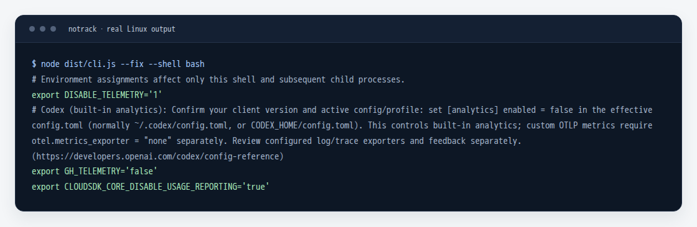

# notrack

只读检查开发工具的遥测设置，内置 40 条工具规则，生成适合你的 shell 的关闭建议。

[English](README.md) | 简体中文



图中是 Linux 上的真实输出，仅为方便阅读调整了换行。`--fix` 只打印建议，由你审阅后自行执行。

## 功能

- **内置 40 条工具规则**，包括 Claude Code、Codex、Gemini CLI、GitHub CLI、Next.js、.NET、Homebrew 和 VS Code。每条规则都注明所覆盖的遥测范围。
- **结果附带判断依据**：探测来源、状态、原因和官方文档。无法确认的设置会如实标为 `unknown`。
- **生成可审阅的关闭片段**，支持 bash、zsh、fish 和 PowerShell；也可输出带 schema 版本的 JSON，方便脚本处理。
- **本地只读扫描**，无遥测、账号或后台服务，安装完成后可离线运行。Windows 的可选诊断数据单独报告。

## 快速开始

需要 Node.js 20+ 和 npm。从仓库页面获取克隆地址，将仓库克隆到本地，然后进入仓库根目录，依次执行：

```sh
npm ci
npm run build
```

接着运行 `node dist/cli.js` 即可扫描。依赖安装好后，也可以用一条 `npm run dev` 完成构建和扫描。

安装依赖可能需要访问 npm registry。安装并构建完成后，扫描和片段生成均使用内置规则，可离线运行。不需要账号、凭据或环境文件；程序没有遥测、后台服务或在线规则更新。

## 使用方法

完成构建后，在仓库根目录运行以下命令。

查看已探测到的工具、安装证据、遥测状态及判断依据：

```sh
node dist/cli.js
```

输出机器可读的报告，当前为 `schemaVersion: 1`：

```sh
node dist/cli.js --json
```

为已探测到、且未确认关闭遥测的工具生成建议：

```sh
node dist/cli.js --fix --shell bash
```

请先检查输出及相关官方文档，再决定是否执行。建议可能是环境变量赋值、配置命令，也可能是说明手动操作步骤的注释。环境变量赋值只影响执行片段的当前 shell 及后续子进程；配置命令在你执行后可能持久化修改设置。

支持的 shell 为 `bash`、`zsh`、`fish` 和 `powershell`。使用 `--fix` 时，Windows 默认选择 PowerShell，其他平台默认选择 bash。`--shell` 必须与 `--fix` 一起使用，`--fix` 不能与 `--json` 同用。

查看全部命令行选项：

```sh
node dist/cli.js --help
```

可用 `--color` 或 `--no-color` 控制表格颜色，用 `--version` 查看包版本。默认仅在终端中、且未设置 `NO_COLOR` 时启用颜色。退出码：扫描或生成成功为 0，规则不可读等全局错误为 1，参数错误为 2。发现遥测开启或状态未知仍退出 0；诊断信息写入标准错误。

## 工作原理

1. 按[内置规则](data/tools.json)声明的 PATH 命令和用户配置路径探测工具。
2. 读取继承的环境变量及规则指定的 JSON/JSONC 字段，在各规则的适用范围内，按有文档依据的退出设置、默认值和优先级判定状态。
3. 输出表格、JSON 报告或 shell 片段。扫描时不运行被检测工具，生成片段时也不执行其中的命令。

扫描为只读操作，不会修改文件、环境变量或注册表。在 Windows 上，程序会查询注册表中的可选诊断数据设置。

## 如何理解结果

结果是根据可见设置作出的推断，受各条规则注明的版本和平台范围限制。

| 状态 | 含义 |
| --- | --- |
| `enabled` | 识别到明确开启遥测的设置。 |
| `default_on` | 未发现可见的覆盖设置，且文档确认默认开启。 |
| `disabled` | 已识别的设置或有文档依据的默认值表明，规则范围内的遥测已关闭。 |
| `unknown` | 设置、权限、版本、渠道或优先级不足以支持可靠判断。 |

`DO_NOT_TRACK=1` 仅影响规则明确支持它的工具，且值必须恰好为 `1`，并非通用关闭开关。JSON 用 `doNotTrack` 表示当前环境是否设置了该值，用每个工具的 `supportsDoNotTrack` 表示其是否支持。工具专用设置及已知优先级仍会影响判定。

探测范围限于规则声明的 PATH 命令和用户配置路径。卸载后遗留的配置文件仍可能被识别为安装证据。程序不扫描项目依赖、项目配置、容器、远程主机或其他用户账号。规则声明的 JSON/JSONC 设置会被解析；其他格式的配置文件可能仅用于确认文件是否存在。

notrack 不检查、捕获或阻止网络流量，无法验证实际是否上报，也无法发现未公开的遥测行为。`disabled` 仅适用于对应规则覆盖的遥测。版本限制、判断依据和官方关闭说明见[内置规则](data/tools.json)。

Windows 的可选诊断数据与开发工具分开报告。访问失败或设置无法识别时返回 `unknown`。其他平台的 JSON 中，`windowsDiagnostics` 为 `null`。

## 环境变量

[`.env.example`](.env.example) 列出了可选的扫描控制项，以及内置规则识别的工具专用退出变量。不需要任何凭据。notrack 读取进程继承的环境，不会自动加载 `.env` 文件；请在运行 CLI 前，在 shell 中导出你选择的设置。

## 测试

在仓库根目录依次运行自动化测试、打包安装检查和依赖审计：

```sh
npm test
npm run test:package
npm run test:audit
```

自动化测试使用合成工具夹具和模拟的 Windows 注册表读取。打包检查会生成本地 tarball，在仓库内的临时目录安装，再用 `npx --offline` 验证安装后的帮助、版本及 JSON 命令。安装运行时依赖可能需要联网，执行检查本身使用离线模式。临时安装目录会在结束后删除。

依赖审计通过 npm registry 查询已知漏洞，包含开发依赖；发现漏洞时返回失败，因此需要网络连接。

## 许可证

采用 [MIT 许可证](LICENSE)。

Built with Claude Code & Codex
